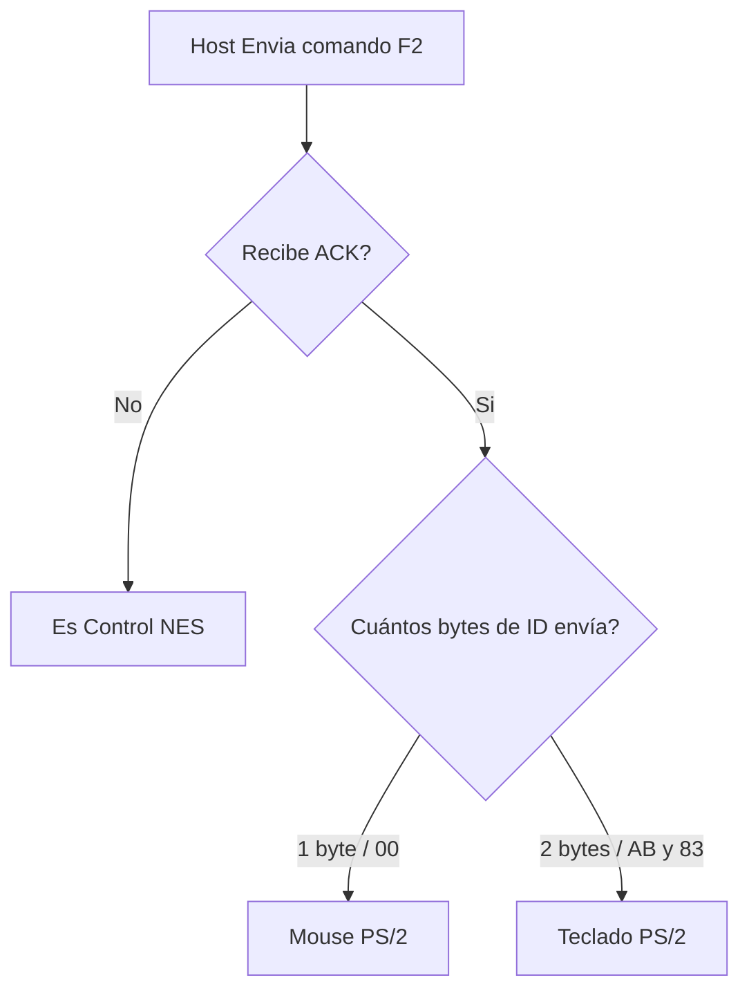
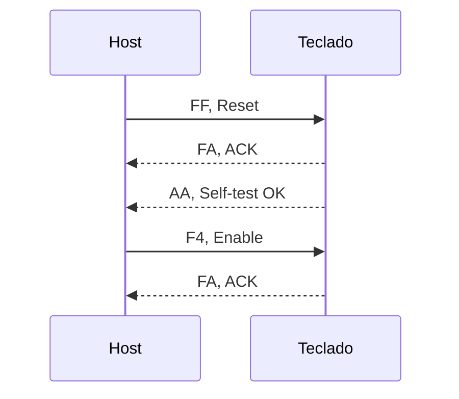

# Funcion dentro del proyecto
El driver PS2 desarrollado en este respositorio cumple la funcion de comunicar la FPGA usada en el proyecto KUBIX2026 con teclados regidos bajo el protocolo de comunicacion PS2, para este fin el driver recibira las instrucciones en el formato propio de cada dispositivo (host y teclado) y trabajara como un traductor capaz de extraer y formatear nuevamente al lenguaje adecuado para que el receptor sea capaz de procesar la informacion.

# Indice

- [Controles de la consola](#controles-de-la-consola)
- [Inicialización](#inicializacion)
  - [Identificar periférico](#identificar-periferico)
  - [Secuencia de inicialización del teclado](#secuencia-de-inicializacion-teclado)
- [Diagrama de flujo para protocolo](#diagrama-de-flujo-para-protocolo)
  - [Diagrama de flujo del funcionamiento](#diagrama-de-flujo-del-funcionamiento)
- [Diagrama de bloques](#diagrama-de-bloques)
- [Diagrama de flujo para comunicación teclado-host](#diagrama-de-flujo-para-comunicacion-teclado-host)
- [Diagrama de flujo para comunicación host-teclado](#diagrama-de-flujo-para-comunicacion-host-teclado)
- [Scan codes](#scan-codes)
  - [Comandos disponibles para el host](#comandos-disponibles-para-el-host)
  - [Comandos disponibles para el teclado](#comandos-disponibles-para-el-teclado)
- [Protocolo PS/2](./Protocolo_PS2.md)

# Controles de la consola

<table align="center">
<tr>
<td align="center">

</td>
<td align="center">

</td>
</tr>
</table>

## Inicializacion

### Identificar Periferico 

<strong>Mostrar diagrama de identificación del periférico</strong>

### Secuencia de inicializacion teclado

El self-test tarda cientos de ms entre `FA` y `AA`. Tras el reset el teclado ya envía scan codes; `F4` solo es necesario despues de un `F5` (disable).

## Diagrama de flujo para el driver

El receptor PS/2 nos pasa cada byte que llega. El driver debe recordar varias cosas, llegó `F0` que me indica que se se va a soltar la tecla de la siguiente trama y `F0`  es tecla extendida e igualmente tiene que esperar a la siguente trama, lo demas son repuestas de control, `FA`, `FE`, `AA`, etc.

<strong>Lista de variables representadas en el flujo</strong>

<ul>
  <li>Found: Representa si el protocolo ha recibido (1) o no ha recibido(0) la trama de datos, esta planteado principalmente para manejo de errores</li>
  <li>E0: indica la deteccion del comando de tecla extendida, el siguiente comando sera de una tecla extendida</li>
  <li>F0: Indica un break, la trama que sigue indica que esa tecla se ha dejado de presionar</strong>.</li>
  <li>Key, Ext_Key: Tecla presionada por el usuario y procesada por el controlador<strong></strong> </li>
</ul>

### Diagrama de flujo del funcionamiento

  

## Diagrama de bloques

 Diagrama planteado para visualizar las funciones del controlador como una serie de bloques con entradas y salidas, debido a su direccionalidad las funciones aqui planteadas deberan ser capaces de realizar el formateo y envio tanto en un sentido como en el otro.

  

## Diagrama de flujo para comunicación teclado-host

  

## Diagrama de flujo para comunicación host-teclado

  

## Scan codes

| Bit | Botón NES | Teclado | Make | Break | Pad | Make | Break |
|:---:|-----------|---------|:----:|:-----:|-----|:----:|:-----:|
| 0 | A      | J       | `3B` | `F0 3B` | 8     | `75`    | `F0 75`    |
| 1 | B      | K       | `42` | `F0 42` | F2    | `06`    | `F0 06`    |
| 2 | Select | Espacio | `29` | `F0 29` | 0     | `70`    | `F0 70`    |
| 3 | Start  | Enter   | `5A` | `F0 5A` | Enter | `E0 5A` | `E0 F0 5A` |
| 4 | Up     | W       | `1D` | `F0 1D` | 2     | `72`    | `F0 72`    |
| 5 | Down   | S       | `1B` | `F0 1B` | 3     | `7A`    | `F0 7A`    |
| 6 | Left   | A       | `1C` | `F0 1C` | .     | `71`    | `F0 71`    |
| 7 | Right  | D       | `23` | `F0 23` | 6     | `74`    | `F0 74`    |

### Comandos disponibles para el host

| Comando | Byte | que hace |
| :---: | :--- | :--- |
| Reset | `FF` |  resetea el teclado y hace self-test |
| Read ID | `F2` | devuelve `FA` y luego `AB 83`, el identificador del teclado PS/2 |
| Enable | `F4` | habilita el envio de scancodes al host |
| disable | `F5` | deshabilita el envio de scancodes al host |
| Resend | `FE` | pide el reenvio del ultimo byte enviado del teclado |
| Echo | `EE` | dato de diagnóstico|

### Comandos disponibles para el teclado

| Comando | Byte | que hace |
| :---: | :--- | :--- |
| ACK | `FA` | comfirma que se recibio un comando |
| Self - test | `AA` | comfirma que se paso el self-test |
| Echo | `EE` | Respuesta al comando `EE` |
| Error | `00` / `FF` | para avisar de Fallo interno |
| Prefijo Extendido | `E0` | se envia antes del codigo de una tecla extendida |
| Resend | `FE` | pide el reenvio del ultimo byte enviado del host |
| break | `F0` | indica que se esta dejando de presionar la tecla de la siguiente trama |

## Responsables

| Integrante |
| :--- |
| Iván Felipe Maluche Suárez |
| Kevin Javier González Luna |
| Santiago Guillén |
| Felipe Hortúa |
