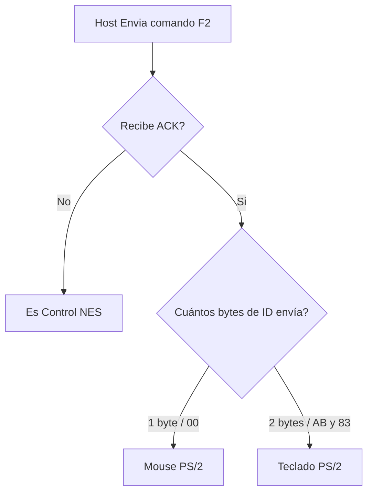
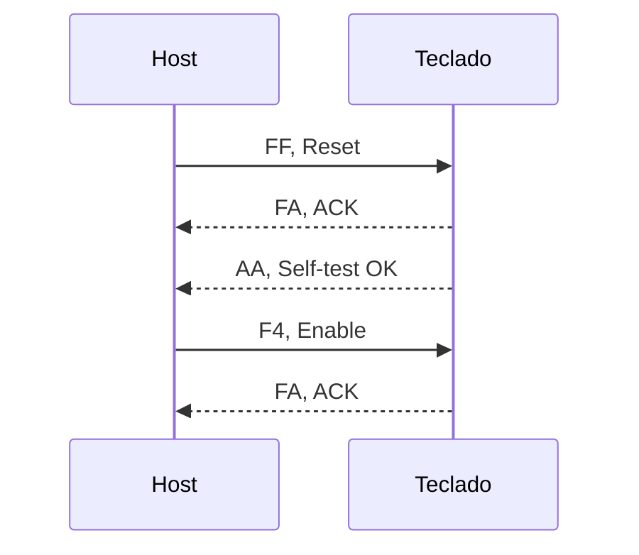
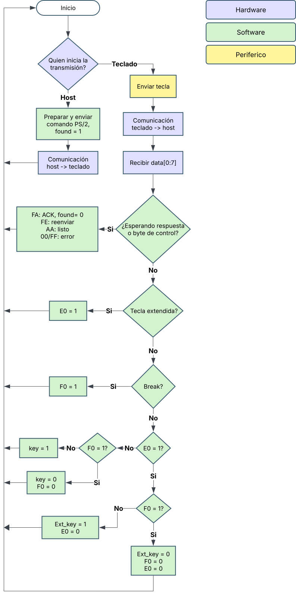
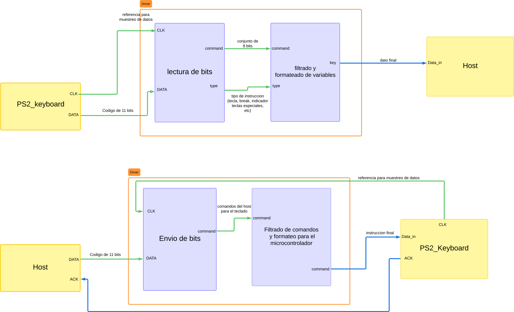

# Funcion dentro del proyecto
El driver PS2 desarrollado en este respositorio cumple la funcion de conectar la FPGA que se usara en el proyecto KUBIX2026 con un teclado regido bajo el protocolo de comunicacion PS2, para este fin el driver hara recibira las instrucciones en el formato propio de cada una de estos dos dispositivos y trabajara como un traductor capaz de extraer y formatear nuevamente al lenguaje adecuado para que el disposito que lo reciba pueda procesas la informacion.
# Controles de la consola

<table align="center">
<tr>
<td align="center">

</td>
<td align="center">

</td>
</tr>
</table>

## Al conectar al puerto
### Identificar Periferico

### Secuencia de inicializacion teclado

El self-test tarda cientos de ms entre `FA` y `AA`. Tras el reset el teclado ya envía scan codes; `F4` solo es necesario despues de un `F5`.

## Funcionamiento

El receptor PS/2 nos pasa cada byte que llega. El driver debe recordar 2 cosas, llegó `E0` que entonces espera a la siguente trama porque es una tecla extendida, y si antes llegó `F0` que espera la siguiente trama para soltar esa tecla.

`FA`, `AA` y `FE` no corresponden a ninguna tecla de los scan codes, así que el driver los ignora.

## Diagrama de flujo para protocolo

### Diagrama de flujo del funcionamiento

  

## Diagrama de bloques

### Diagrama de bloques general como traducción de los diagramas de flujo de manera más distendida. 

  

## Diagrama de flujo para comunicación teclado-host

  

## Diagrama de flujo para comunicación host-teclado

  

## Scan codes

| Bit | Botón NES | Teclado | Make | Break | Pad | Make | Break |
|:---:|-----------|---------|:----:|:-----:|-----|:----:|:-----:|
| 0 | A      | J       | `3B` | `F0 3B` | 8     | `75`    | `F0 75`    |
| 1 | B      | K       | `42` | `F0 42` | F2    | `06`    | `F0 06`    |
| 2 | Select | Espacio | `29` | `F0 29` | 0     | `70`    | `F0 70`    |
| 3 | Start  | Enter   | `5A` | `F0 5A` | Enter | `E0 5A` | `E0 F0 5A` |
| 4 | Up     | W       | `1D` | `F0 1D` | 2     | `72`    | `F0 72`    |
| 5 | Down   | S       | `1B` | `F0 1B` | 3     | `7A`    | `F0 7A`    |
| 6 | Left   | A       | `1C` | `F0 1C` | .     | `71`    | `F0 71`    |
| 7 | Right  | D       | `23` | `F0 23` | 6     | `74`    | `F0 74`    |

### Comandos disponibles para el host

| Comando | Byte | que hace |
| :---: | :--- | :--- |
| Reset | `FF` |  resetea el teclado y hace self-test |
| Read ID | `F2` | devuelve `FA` y luego `AB 83`, el identificador del teclado PS/2 |
| Enable | `F4` | habilita el envio de scancodes al host |
| disable | `F5` | deshabilita el envio de scancodes al host |
| Resend | `FE` | pide el reenvio del ultimo byte enviado del teclado |
| Echo | `EE` | dato de diagnóstico|

### Comandos disponibles para el teclado

| Comando | Byte | que hace |
| :---: | :--- | :--- |
| ACK | `FA` | comfirma que se recibio un comando |
| Self - test | `AA` | comfirma que se paso el self-test |
| Echo | `EE` | Respuesta al comando `EE` |
| Error | `00` / `FF` | para avisar de Fallo interno |
| Prefijo Extendido | `E0` | se envia antes del codigo de una tecla extendida |
| Break | `FE` | pide el reenvio del ultimo byte enviado del host |
| Resend | `EE` | Respuesta al comando `EE` |

## Responsables

| Integrante |
| :--- |
| Iván Felipe Maluche Suárez |
| Kevin Javier González Luna |
| Santiago Guillén |
| Felipe Hortúa |
