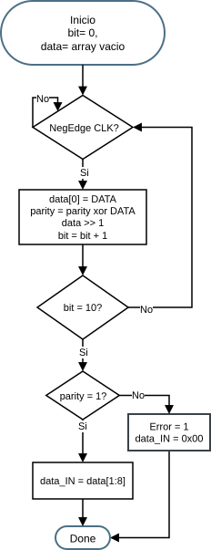
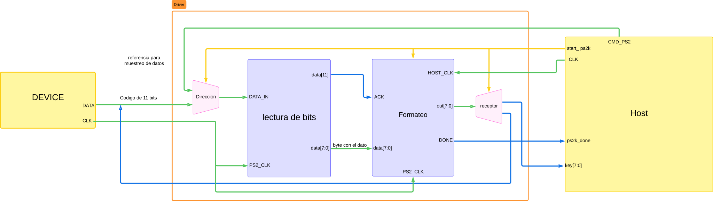

# Diagramas de flujo del driver PS/2

## Índice

- [Flujo principal](#flujo-principal)
- [Recepción del teclado](#recepción-del-teclado)
- [Transmisión al teclado](#transmisión-al-teclado)
- [Identificación de trama](#identificación-de-trama)
- [Documentación del proyecto](Ps2_alProyecto.md)
- [Protocolo PS/2](Protocolo_PS2.md)

## Flujo principal

  

## Recepción del teclado

  

## Transmisión al teclado

  

## Identificación de trama

  

## Diagrama bloques

  

